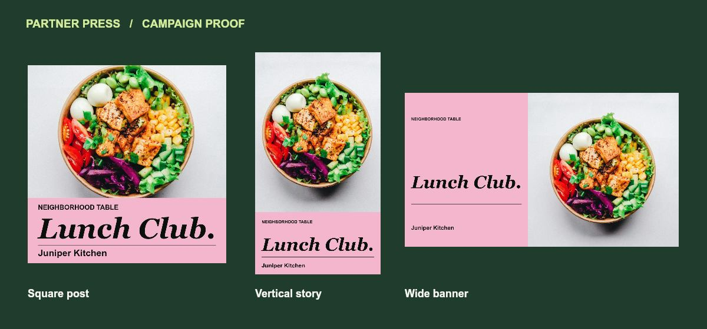

# Partner Press for restaurant weeks

Give every restaurant the same campaign artwork and let each kitchen feature its own dish. A restaurant chooses a photo, checks the crop, and downloads a square post, vertical story, and wide banner. Photos stay on its device.

### One campaign · $299 total

One organizer pays Blairstone Studio once. Up to ten participating restaurants can use the kit at no charge. The organizer supplies approved artwork. Blairstone prepares one campaign identity in three layouts, includes one proof revision, and delivers a ready-to-share partner page with instructions. Larger or multi-campaign programs are quoted separately.

**[Request the $299 campaign kit](mailto:cliffordRyanNelson@gmail.com?subject=Partner%20Press%20%E2%80%94%20%24299%20campaign%20kit&body=Hi%20Clifford%2C%0A%0AOur%20organization%20is%20%5Bname%5D.%20We%27re%20planning%20%5Bcampaign%5D%20for%20%5Bdate%5D%20with%20%5Bcount%5D%20restaurants.%20Please%20confirm%20the%20scope%20and%20timing%20of%20the%20%24299%20kit.)** · Email cliffordRyanNelson@gmail.com. We confirm the scope and delivery date before invoicing.

### Try the restaurant workflow

**[Download the working demo](https://github.com/commander-clifford/uber-eats-pics/raw/refs/heads/partner-press-demo/demo/Partner-Press.html)** and open the HTML file in a desktop browser. Choose **Try the restaurant demo**, use the sample dish or add your photo, then download a format or all three as a ZIP. The demo runs locally once downloaded.

Partner Press is an independent Blairstone Studio project by Clifford Nelson. Lunch Club, Neighborhood Table, and Juniper Kitchen are fictional demo names.
